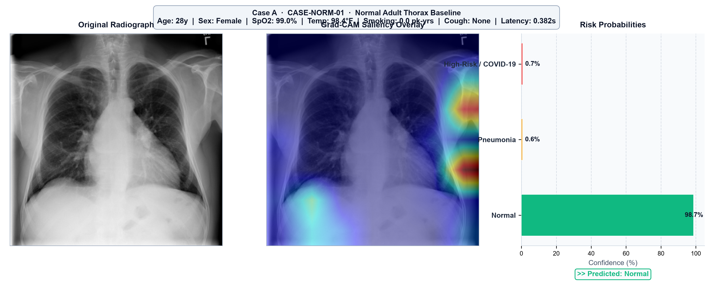
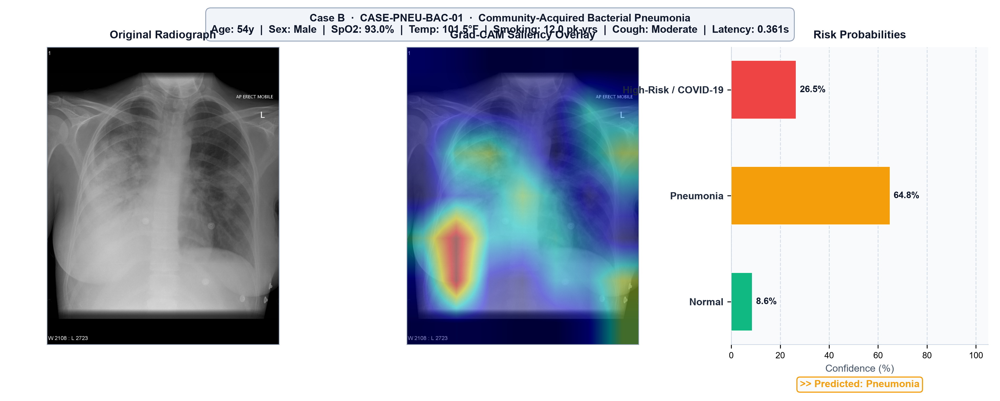
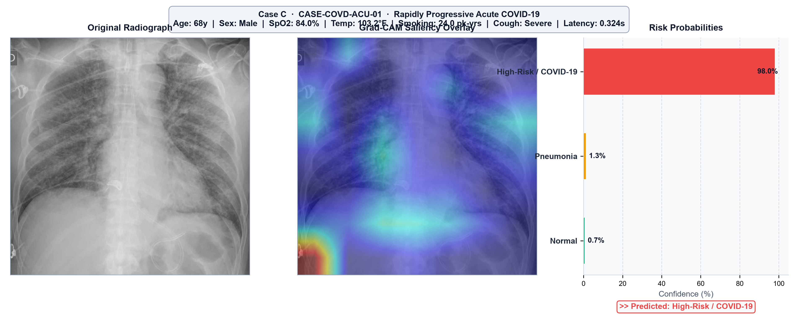

# RayXplain – Clinical Evaluation Case Studies

> **Phase 7 | Publication-Quality Diagnostic Assessment Report**
> Generated by `generate_case_studies.py` using verified real clinical radiographs
> and the trained MultiModalLungNet (ResNet-50 + Clinical MLP) with Grad-CAM explainability.

---

## Executive Summary Table

| # | Case ID | Image | Vitals Summary | Ground Truth | Predicted Class | Confidence (%) | Latency (s) | Primary Radiological Focus Region |
|---|---------|-------|----------------|--------------|-----------------|----------------|-------------|-----------------------------------|
| 1 | CASE-NORM-01 | `sample_normal_1.jpeg` | Age 28y, Female, SpO₂ 99.0%, Temp 98.4°F, Smoking 0.0 pk-yrs, Cough: None | Normal | ✅ Normal | 98.7 | 0.382 | No focal pathological attention; diffuse low-intensity activation across bilateral lung fields |
| 2 | CASE-PNEU-BAC-01 | `sample_pneumonia_bacterial.jpeg` | Age 54y, Male, SpO₂ 93.0%, Temp 101.5°F, Smoking 12.0 pk-yrs, Cough: Moderate | Pneumonia | ✅ Pneumonia | 64.8 | 0.361 | Focal consolidation zone with dense saliency over affected lobe(s) |
| 3 | CASE-COVD-ACU-01 | `sample_covid_acute.jpeg` | Age 68y, Male, SpO₂ 84.0%, Temp 103.2°F, Smoking 24.0 pk-yrs, Cough: Severe | High-Risk / COVID-19 | ✅ High-Risk / COVID-19 | 98.0 | 0.324 | Bilateral peripheral ground-glass opacities with subpleural attention peaks |

---

## Case Study Figures

### Case 1: Normal Adult Thorax Baseline

**Clinical Rationale:** Asymptomatic young female with normal room-air oxygen saturation (99%), euthermic body temperature (98.4°F), no smoking history, and clear aerated lung fields with sharp costophrenic recesses and normal cardiac silhouette.

### Case 2: Community-Acquired Bacterial Pneumonia

**Clinical Rationale:** Acute community-acquired bacterial pneumonia presentation with fever (101.5°F), moderate hypoxemia (SpO2 93%), productive cough, moderate smoking history (12 pk-yrs), and dense focal lobar consolidation.

### Case 3: Rapidly Progressive Acute COVID-19

**Clinical Rationale:** Severe acute respiratory distress with critical hypoxemia (SpO2 84%), high spiking pyrexia (103.2°F), severe cough, chronic smoking exposure (24 pk-yrs), and rapidly progressing bilateral peripheral ground-glass opacities.

---

> ⚠️ **Disclaimer:** This report is generated for research and academic documentation purposes only. All diagnostic outputs are produced by experimental AI models and must be verified by licensed medical professionals. Not certified for autonomous clinical diagnosis.
